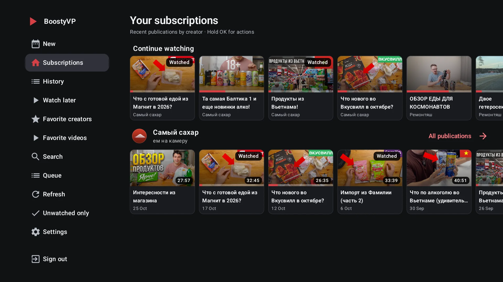
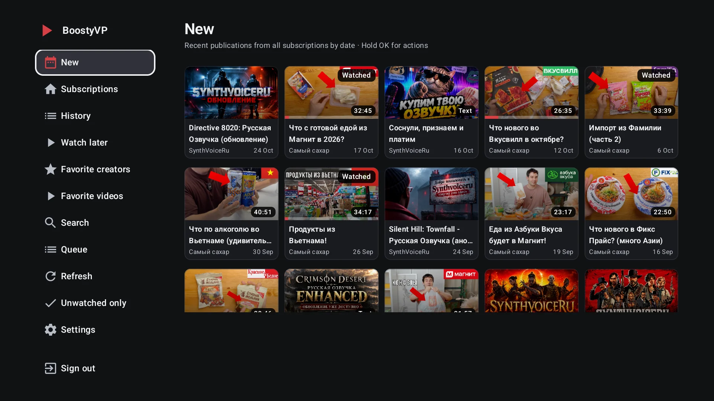
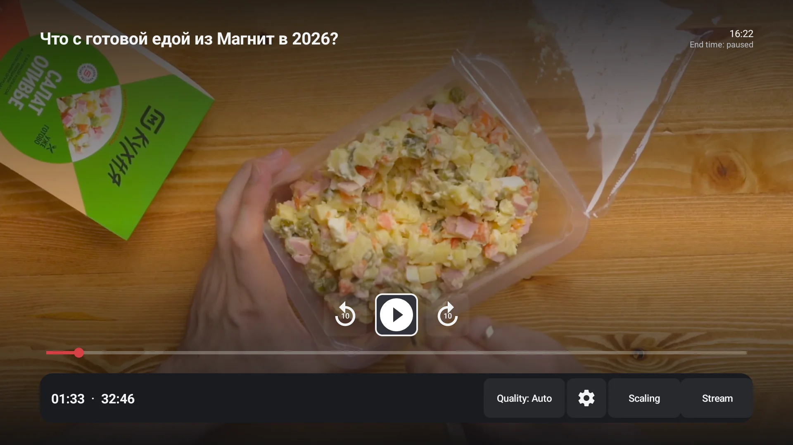
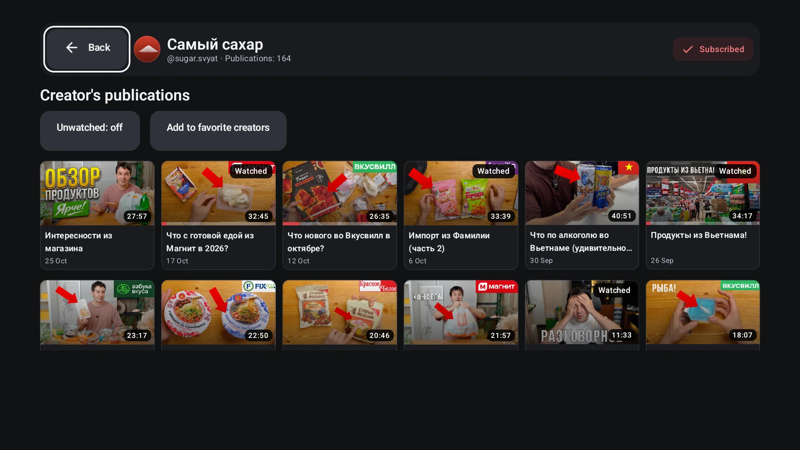
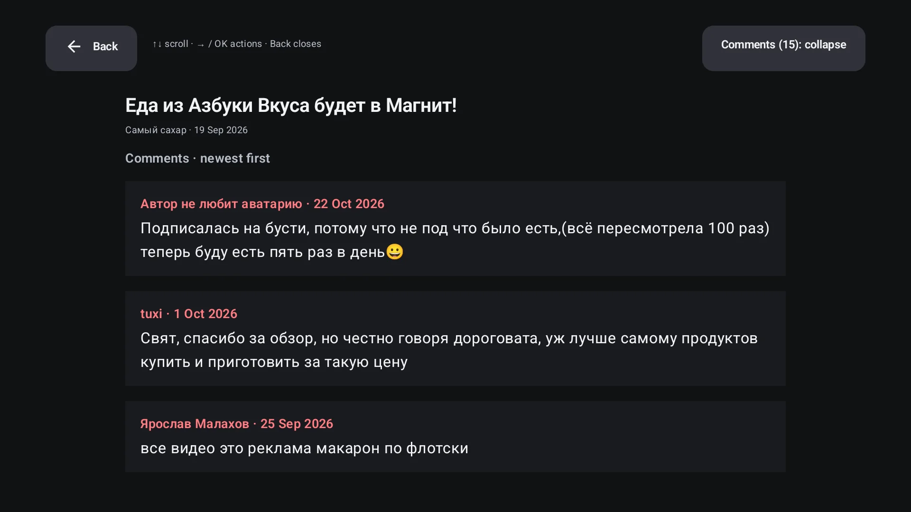
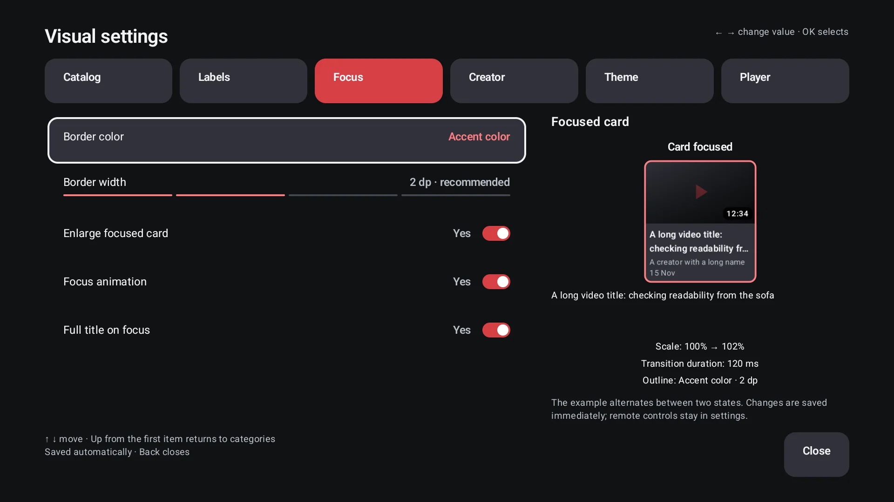
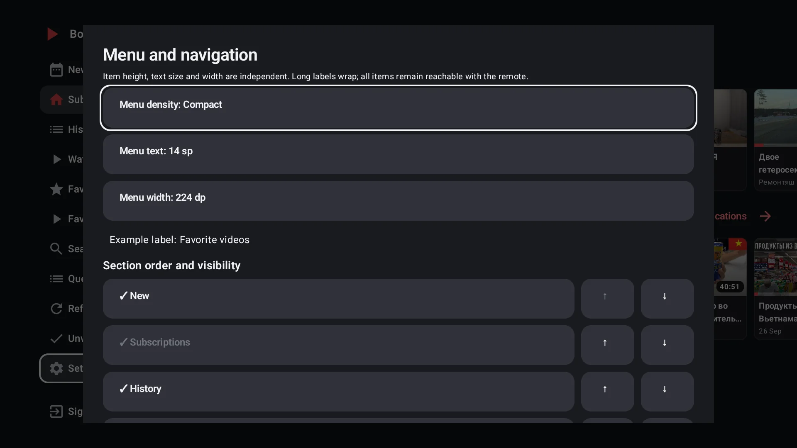

# BoostyVP

> [!IMPORTANT]
> **[User guide — installation, sign-in and remote controls](docs/USER_GUIDE.en.md)**
>
> **[Руководство на русском](docs/USER_GUIDE.md)** · [Русский README](README.md)

**Your Boosty subscriptions, on the big screen.**

An independent Boosty client for Android TV / Google TV with native playback,
Russian and English interfaces, dark themes and standard remote controls.
SmartTube inspires its usability; BoostyVP is not a Boosty edition of SmartTube.

[Project website](https://rico-x.github.io/BoostyVP/en/) · [Releases](https://github.com/rico-x/BoostyVP/releases) ·
[Documentation](docs/README.en.md) · [Changes](CHANGELOG.en.md) · [Roadmap](docs/ROADMAP.en.md)

| Browse | Watch |
|---|---|
|  |  |
|  |  |
|  |  |

## Features

- Creator subscriptions, the combined New feed, creator pages, watch history
  and Continue watching, separated by account.
- Watch later, favorite videos and creators, watched markers,
  search within the loaded catalog and a queue for the current session.
- Media3 playback: accelerated seeking, quality, global or per-creator speed,
  next video, sleep timer, stream information and signed-link recovery.
  Leaving the app pauses playback and preserves the position according to privacy settings.
- Text posts with images and comments. Hold OK on a video card → Comments
  to read the discussion without starting the video.
- Five card sizes, independent captions, density and focus styling,
  compact creator headers, dark themes and accents. The sidebar shifts the catalog;
  its width, density, text size, section order and visibility are configurable.
- Immediate settings persistence, library and privacy controls,
  non-secret settings export/import, Android TV / Projectivy channels
  and manual update checks.

Search only covers loaded cards; the queue does not survive process termination.
Comments are read-only. Cross-device library sync, live streams, SponsorBlock
and timeline frame previews are not advertised features.

## Installation

Android **6.0+** (API 23), package `io.github.ricox.boostyvp`. Builds support
ARMv7, ARM64, x86, x86_64 and **universal**. Choose universal when the TV's
Android architecture is unknown: CPU bitness may differ from OS bitness.
An update signed with the same key installs over the existing package,
preserving sign-in and data.

Public APKs appear only in [Releases](https://github.com/rico-x/BoostyVP/releases)
and on the [website](https://rico-x.github.io/BoostyVP/en/). No releases means
there is no public APK yet. These documents describe current `main`; a published
APK's release notes define its contents. Debug artifacts from Actions are not stable releases.

**[Step-by-step installation and sign-in →](docs/USER_GUIDE.en.md#installation)**

## Documentation and status

- [User guide](docs/USER_GUIDE.en.md) · [Русский](docs/USER_GUIDE.md).
- [All RU / EN documents](docs/README.en.md), [verification and release readiness](docs/RELEASE_READINESS.en.md).
- [Development](docs/DEVELOPMENT.en.md), [publishing and APK verification](docs/RELEASING.en.md), [roadmap](docs/ROADMAP.en.md).
- [Contributing](CONTRIBUTING.en.md), [LLM involvement](docs/AI_ASSISTANCE.en.md), [privacy](docs/PRIVACY.en.md), [security](SECURITY.en.md).

Early experimental software. Paid posts require a valid subscription; access
restrictions are not bypassed. BoostyVP is not affiliated with Boosty or SmartTube.
The app contains no LLM integration, project advertising or project analytics.

**MIT covers original fork contributions only.** Inherited ARDcode code has not
been relicensed: [license](LICENSE.en.md), [provenance](NOTICE.en.md),
[third-party components](docs/THIRD_PARTY.en.md), [disclaimer](DISCLAIMER.en.md).
