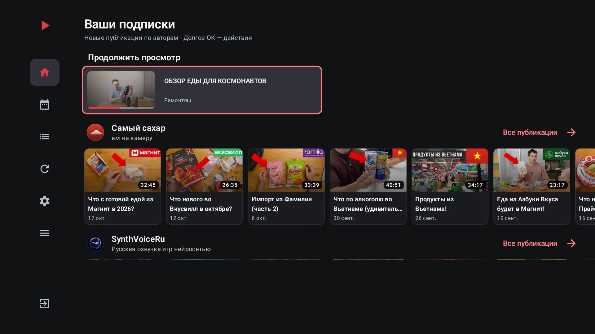
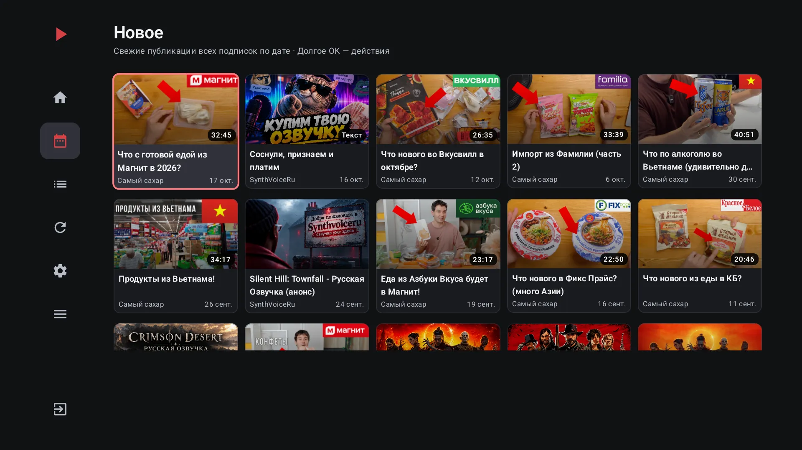
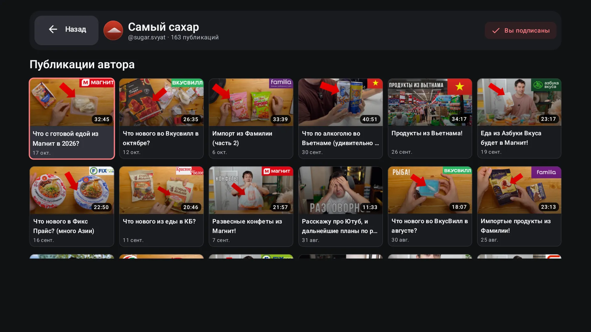
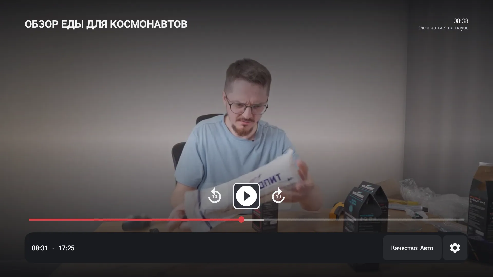
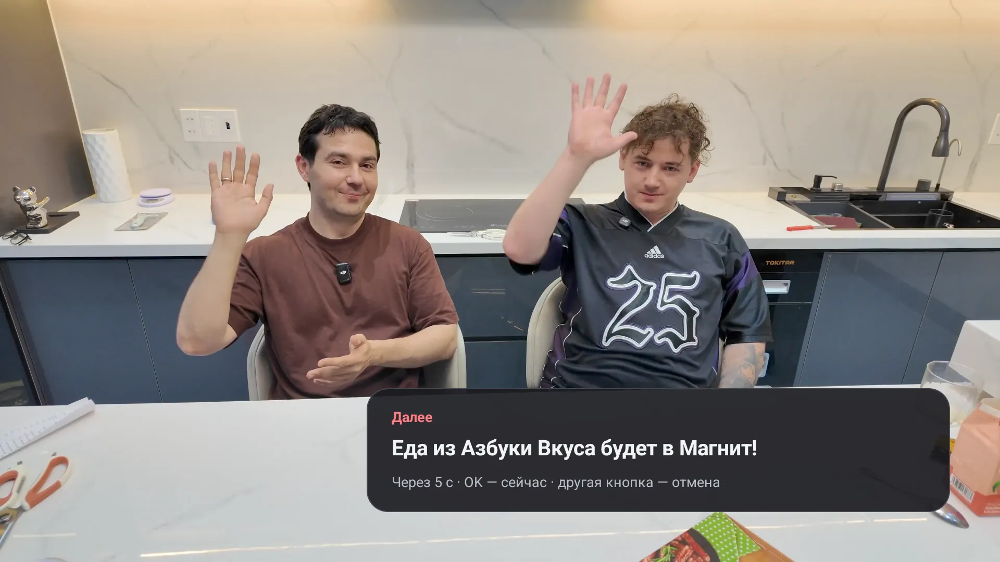
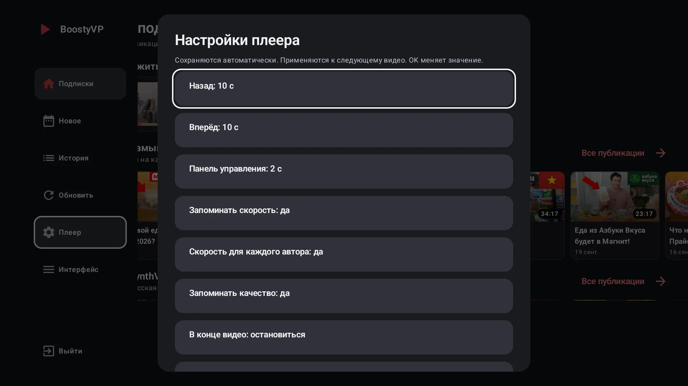
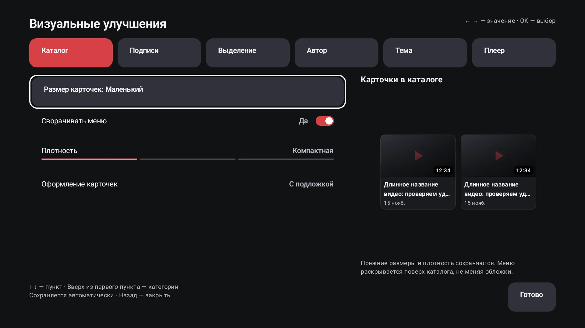

# BoostyVP

**Ваши подписки Boosty — на большом экране.**

Независимый клиент Boosty для Android TV / Google TV. Русский интерфейс,
тёмная тема и управление обычным пультом. Развивается как самостоятельный
форк с интерфейсом и удобством просмотра, ориентированными на SmartTube.

[Сайт и скачивание](https://rico-x.github.io/BoostyVP/) ·
[Все выпуски](https://github.com/rico-x/BoostyVP/releases) ·
[Руководство](docs/USER_GUIDE.md) · [Что нового](CHANGELOG.md) · [Roadmap](docs/ROADMAP.md)

| | |
|---|---|
|  |  |
|  |  |
|  |  |

Ранний pre-release. Версия — дата выпуска и его номер за день (`2026.10.24.1`);
каждый APK перед публикацией проверяется ClamAV и VirusTotal.

Разработка ведётся с участием [LLM-ассистентов](docs/AI_ASSISTANCE.md).
MIT относится **только к оригинальным изменениям форка**, не ко всему
унаследованному коду или APK: [лицензирование](LICENSE.md), [происхождение](NOTICE.md).
Перед использованием прочтите [отказ от гарантий](DISCLAIMER.md),
[ограничения безопасности](SECURITY.md) и [описание данных](docs/PRIVACY.md).

Приложение не связано с администрацией Boosty или SmartTube. Для платного
контента нужна действующая подписка соответствующего уровня. Ограничения
доступа не обходятся. Источник проекта и сведения об авторстве — в [NOTICE](NOTICE.md).

## Возможности

- Подписки по авторам, общая лента «Новое», страницы авторов, «Продолжить
  просмотр» и локальная «История» — отдельно для каждого аккаунта Boosty.
- Нативный Media3-плеер: перемотка пультом с ускорением, качество и скорость
  (общая или для каждого автора), следующее видео автора, таймер сна,
  восстановление истёкших ссылок; экран не гаснет во время просмотра.
- Вход по QR через браузер телефона/компьютера или по номеру телефона.
- Тексты с изображениями и свёрнутыми комментариями (только чтение).
- Настраиваемый вид: пять размеров карточек, подписи, плотность, темы, акценты,
  шапка автора и вид плеера.

«Смотреть позже», избранное и поиск пока не реализованы: они описаны в
[дорожной карте](docs/ROADMAP.md), а не заявлены как готовые функции.

## Установка

Скачайте APK на [сайте проекта](https://rico-x.github.io/BoostyVP/) или в
[Releases](https://github.com/rico-x/BoostyVP/releases). Если архитектура
Android на ТВ неизвестна, выбирайте **universal**. Минимальная версия — Android 6.0,
пакет `io.github.ricox.boostyvp`. Обновления ставятся поверх, без удаления
приложения и повторного входа. Подробности, проверка подписи и вход — в
[руководстве](docs/USER_GUIDE.md#установка).

## Документация

- [Руководство пользователя](docs/USER_GUIDE.md): вход, управление пультом, плеер, внешний вид.
- [Выпуски, версии и проверка APK](docs/RELEASING.md), [история изменений](CHANGELOG.md).
- [Разработка и проверка](docs/DEVELOPMENT.md): сборка в Docker, тесты, ТВ, скриншоты.
- [Дорожная карта и статус задач](docs/ROADMAP.md).
- [Правила участия](CONTRIBUTING.md), [участие LLM](docs/AI_ASSISTANCE.md).
- [Безопасность](SECURITY.md), [данные](docs/PRIVACY.md), [сторонние компоненты](docs/THIRD_PARTY.md).
