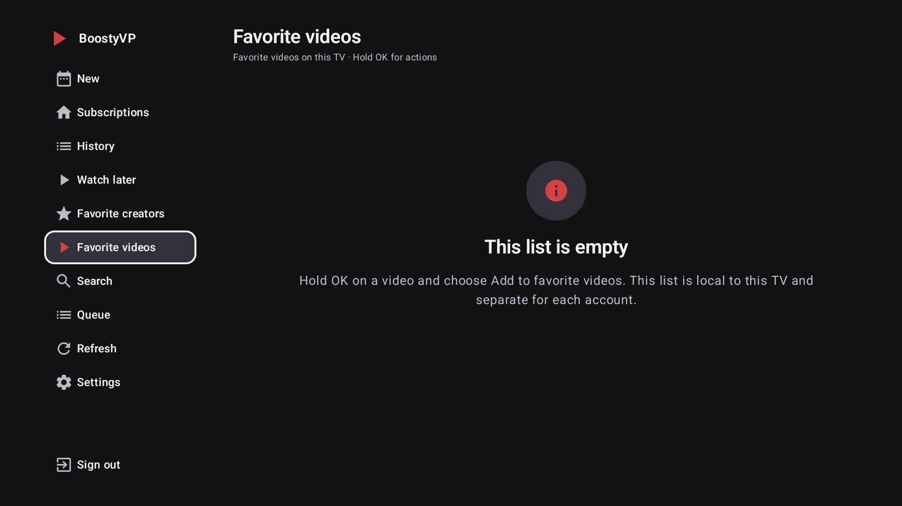
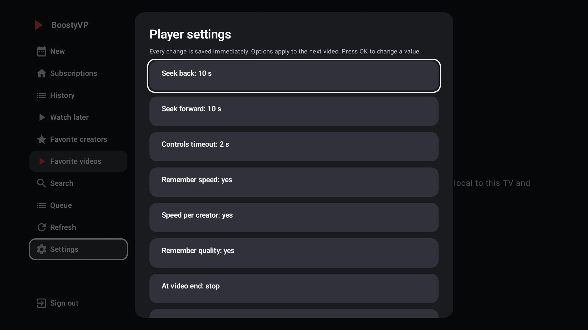
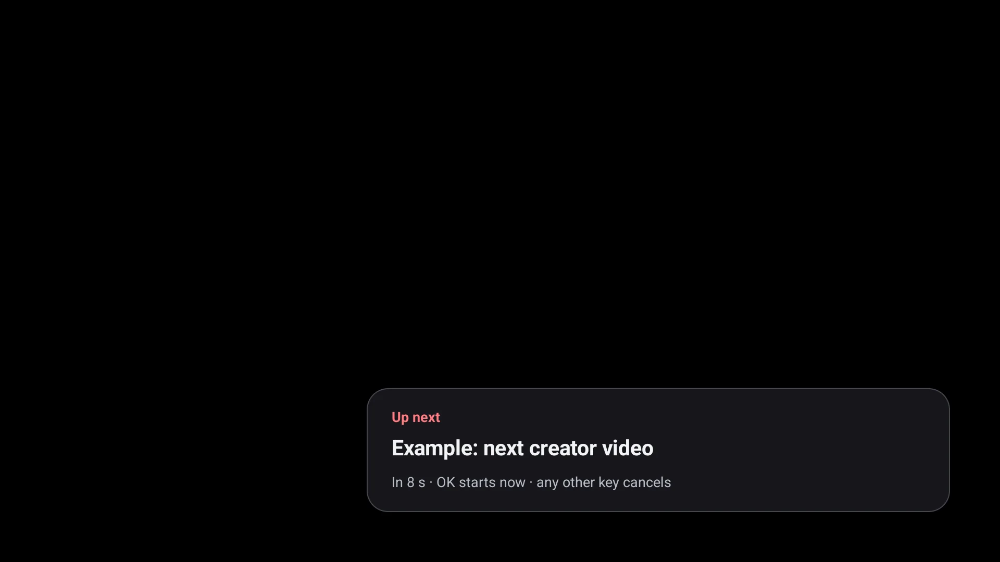
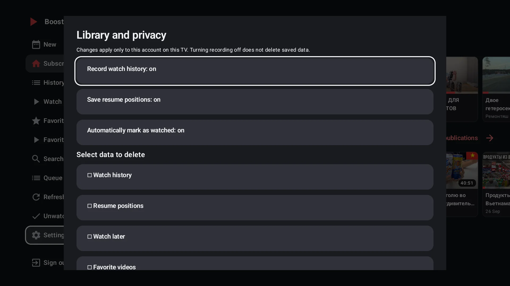
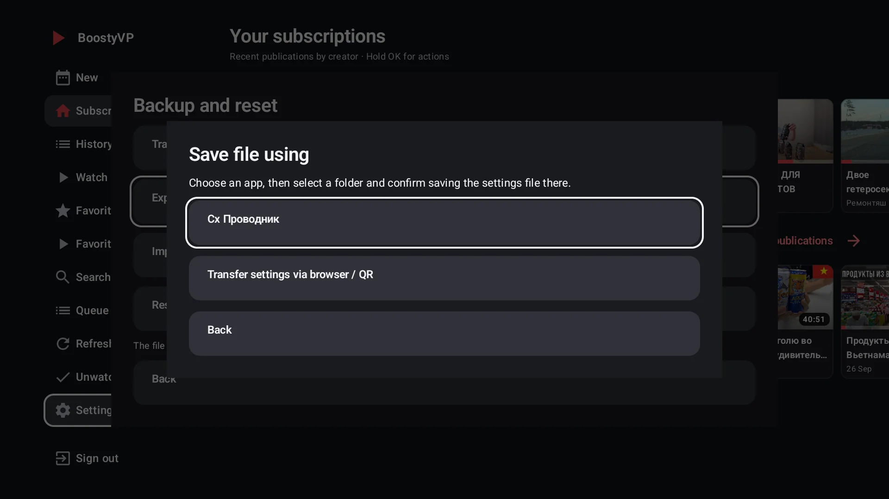

# BoostyVP user guide

[Русский](USER_GUIDE.md) · [All documentation](README.en.md) · [Project home](../README.en.md)

This guide describes current `main`. Screenshots show real BoostyVP 2026.10.25.1
on Android TV; publication titles and artwork belong to their creators.
Next-up shows the current native component using demonstration data without an account; see [provenance](screenshots/README.md). For a published APK, also check its change notes.

- [Installation](#installation)
- [Sign-in](#sign-in)
- [Remote controls and navigation](#remote-controls-and-navigation)
- [Catalog and library](#catalog-and-library)
- [Player](#player)
- [Posts and comments](#posts-and-comments)
- [Appearance, menu and language](#appearance-menu-and-language)
- [Library and privacy](#library-and-privacy)
- [Settings transfer](#settings-transfer)
- [Android TV and Projectivy channels](#android-tv-and-projectivy-channels)
- [Updates and help](#updates-and-help)

## Installation

Requires Android 6.0+ (API 23), Android TV or Google TV. The application package
is `io.github.ricox.boostyvp`. Paid posts require the appropriate Boosty subscription.

1. Open [Releases](https://github.com/rico-x/BoostyVP/releases) or the
   [project website](https://rico-x.github.io/BoostyVP/en/). If there are no
   releases, no public APK has been published yet. Actions debug artifacts are for testing.
2. Choose **universal** if you do not know the TV's Android architecture.
   ARMv7, ARM64, x86 and x86_64 builds are also supported. A 64-bit CPU may run
   a 32-bit OS; separate APKs for each Android version are unnecessary.
3. Transfer the APK to the TV and open it. If Android requests permission to
   install apps, grant it to your chosen installer and confirm installation.
4. Launch BoostyVP and sign in. This is an independent app; another client's
   sign-in is not imported automatically.

Install updates **over the existing app**, with the same package and signing key.
Uninstalling removes local data and is unnecessary for a normal update.
See [APK verification](RELEASING.en.md#apk-verification) for checksums and certificates.

## Sign-in

### From a phone or computer

The TV and browser must be on the same trusted home network.

1. On the TV, choose the phone/computer option and open its address or QR code.
2. Save the **BoostyVP** browser bookmark offered by the page. On a computer,
   drag it onto the bookmarks bar.
3. Run the bookmark on the connection page to check that it works.
4. Open Boosty using the page's button and sign in **on Boosty's website**.
5. Run the bookmark in that Boosty tab, then confirm session transfer on the
   connection page it returns to. Keep the TV sign-in screen open.

In Android Chrome, select the saved bookmark from the address-bar suggestion
with a star and `javascript:`; pressing Enter alone does not run it.
If a bookmark from a previous client remains, create a new BoostyVP bookmark.

### Sign in on this TV

Enter your phone number and the six-digit code you receive. Selecting a field
opens the TV keyboard. Back dismisses the keyboard; then Up/Down moves through
the controls. If Boosty requires CAPTCHA, use browser sign-in instead.

Do not send passwords or codes to the maintainer. Pairing uses local HTTP:
use a trusted network, do not share its address/QR code and do not expose the
TV port to the internet. See [Security](../SECURITY.en.md).

## Remote controls and navigation

| Button | Action |
|---|---|
| Arrow keys | Select controls and cards; read/scroll text |
| OK | Open a card or select an action; reveal video controls |
| Hold OK on a card, or Menu | Open post actions |
| Back | Close a dialog/post; hide player panels before exiting |
| Right from the sidebar | Move into the catalog |
| Left from the catalog's first column | Return to the sidebar |
| Play/Pause, FF/REW | Control playback; settings can remap these buttons |

Releasing a held OK **does not select** an action or close the menu.
After release, choose an action with the arrows and a separate OK, or press Back.
OK on the selected sidebar section moves focus into its contents.
Long menus scroll. Expanding the sidebar **shifts the catalog** rather than
covering it; the number of visible columns can change.

## Catalog and library

**Subscriptions** shows recent posts grouped by creator. Creators appear as
they load; one failure does not hide the others. Refresh keeps visible cards
while loading, and failed requests have a retry action.

**New** combines subscription posts and loads further pages. It starts loading
when first opened. Back returns to Subscriptions. A **creator page** contains
that creator's posts, its own unwatched filter and pagination.

Hold OK / Menu offers opening, starting from the beginning, creator navigation,
video comments, queue and library actions, watched markers, full title and details.
Available actions depend on the post and section. Starting from the beginning
only changes that launch; it does not disable position saving.

- **Continue watching** lists started videos with saved positions.
- **History** is local and includes completed videos. Removing an entry does not
  remove its resume position or other lists.
- **Watch later** saves video and text bookmarks; it does not download content.
- **Favorite videos** and **Favorite creators** are separate lists, independent
  of Watch later. Removing a favorite creator does not cancel a subscription.
- **Only new** filters unwatched posts in Subscriptions/New; creator pages have
  their own switch. It does not hide History or saved lists.
- **Watched / unwatched** is a separate marker, preserving history and position.
  Automatic marking uses the final 5%, with a window of at least 30 seconds.

Saving a card does not unlock a restricted post: access is checked again on
opening. The library is stored on this TV, separately per account.
Cross-device synchronization is not implemented.

### Search and queue

**Search** covers up to 600 metadata entries already loaded in the current
session, not the whole Boosty service. Load more feed/creator pages to expand
coverage. Creator, post-type, access and sort filters are available.

The **queue** holds up to 100 unique videos in the current session. Hold OK →
queue action adds/removes a video; the Queue section can start, reorder and
remove items. Clearing the queue requires confirmation. The next item is offered
with a cancellable countdown. Switching accounts or terminating the process
clears the queue; it does not replace Watch later.

## Player

With controls hidden, Left/Right seeks by the configured increment. Rapid presses
accumulate; holding accelerates seeking, applied on release. The overlay shows
the offset and target time. With controls visible, arrows select buttons and
the seek bar. Paused controls remain visible until Back; Menu reveals them
without changing playback.

Home, another app or the launcher pauses video. Returning preserves the point
and previous playback intent: an already paused video should stay paused.
Writing positions to disk follows the privacy setting; with recording disabled,
the current session's point remains in memory.

Settings → Player provides:

- Backward steps of 5/10/15/30 seconds, forward steps of 10/15/30/60 seconds;
  controls visible for 2/4/8 seconds or indefinitely. Defaults: 10 back, 30 forward, 4-second controls.
- Remembered speed and quality, with optional per-creator speed. Select speed
  in the player menu; quality is carried over at the same height or the nearest lower one.
- End action: stop (default), next creator video, repeat or close. Next video
  has an 8-second countdown: OK starts immediately, another button cancels.
- Sleep timer: off / 30 minutes / 1 / 2 / 3 hours without remote input,
  followed by pause and a message.
- Independent remapping: CH± navigates creator videos, FF/REW navigates instead
  of seeking, digits 0–9 seek to 0–90% of duration. Disabled by default.
- Double Back: with panels hidden, a second press within 2 seconds exits.
  Closing a panel does not confirm exit. Disabled by default.
- Scale: fit, width, height, stretch or crop-to-fill. These change geometry,
  not color, sharpness, HDR or image processing.

Stream or INFO shows codec/decoder, resolution, frame rate, declared bitrate,
audio, buffer and frame counters. Bitrate is not connection speed. Unknown
values are labeled; private media URLs are not displayed. Back hides stream
information, then controls, then closes the video.

When links are exhausted or buffering persists for 20 seconds in a minute,
the app fetches the post again and continues from the same point. Automatic
recovery has a 2-minute interval; Retry on the error screen acts immediately.
The screen stays awake while playing; normal TV power rules apply when paused.

When a saved position is within the final 10 seconds or 5% (whichever is larger),
ordinary reopening starts from the beginning. Restoring an already open player
preserves its current session point instead.

## Posts and comments

For video posts: **hold OK on the card → Comments**. The discussion opens
immediately without starting the video. Short OK opens a text post;
its comments start collapsed and the top button expands/collapses them.

Up/Down scrolls text; Page Up/Down moves almost a screen. Right or OK moves
focus to a visible reply / Load more action or the top comments button.
Left from an action returns to reading. Back returns to the card.
Replies expand separately; load subsequent pages with the button.
Comments are read-only: posting and editing are not implemented. Restricted
posts show the available teaser; creator-disabled discussions are not requested.
Failed loads can be retried.

Post details in the card menu shows the full title, creator, date, access,
duration/resolution when available, comment count and description.
Up/Down scrolls the description; fresh data is used to check access.

## Appearance, menu and language

Ordinary settings **save immediately**. Back and Close preserve your choice;
there is no separate Save step. Imports, resets and data deletion have their
own confirmations.

Appearance has six categories: catalog, captions, focus, creator, theme and player.
Up/Down selects a control, Left/Right changes values and OK cycles a value.
A live preview alternates focused/unfocused states to show outline, zoom and animation.

Five cover sizes: **96 / 124 / 160 / 216 / 296 dp**. The original 216 dp size is
the fourth step. The slider shows how many full cards fit in the available
width. Title and metadata sizes, 1–3 title lines, creator/date/duration and
repeated-creator visibility are independent controls. There are three catalog
densities, two card styles, four creator-header densities, black/graphite themes,
five accents, 1–4 dp outlines and optional focus zoom/animation. Player appearance
settings do not process the video image.

Menu and navigation offers four densities, **12/14/16/18 sp** text,
**192/224/256 dp** width, ordering and section visibility. Subscriptions and
Settings stay accessible; refresh, filter and sign-out can be hidden separately.
Menu width preserves the chosen cover size but changes available catalog space.

Interface language: System default / Русский / English. System default chooses
Russian for a Russian OS, otherwise English. Changing language preserves sign-in
and the library. Creator names and posts are not translated; browser pages and
native player controls use the selected language.

## Library and privacy

Three switches control history, positions and automatic watched recording for
the current account; all start enabled. Disabling recording does not erase
existing data or prevent manual bookmarks.

To clear data, select groups: history, positions, Watch later, favorite videos,
favorite creators or watched markers. Delete selected requires a separate
confirmation, initially focused on Cancel. Sign-in, settings, other accounts
and server subscriptions are preserved. Clear the queue in its own section.

## Settings transfer

JSON contains only player, appearance and channel preferences. It **excludes**
sign-in, passwords, tokens, account details, subscriptions, library, positions,
queue and individual creator speeds. Unsupported formats/keys are rejected before writing.

- **Export to a file on TV:** choose an app, then a folder and confirm saving
  in that file manager. Cx File Explorer works on the tested TV. Real system
  document creation is also supported. Opening a manager does not mean the
  file was written; cancellation does not change preferences.
- **Import file:** choose a manager/JSON file. Validated preferences are applied;
  sign-in and library data are not imported.
- **Transfer settings via browser / QR:** open the address on the same trusted
  network and download/upload JSON. Applying an uploaded file requires confirmation
  on the TV. The page runs for up to 10 minutes and stops on leaving the section
  or backgrounding the app. This is the fallback when no saving app is available.

Do not share its address/QR: local HTTP does not encrypt settings transfer.
Reset settings requires confirmation and does not remove sign-in or library data.

## Android TV and Projectivy channels

By default, **one New channel** is enabled. Choose 1–5 channels in settings:
New, Continue watching, Watch later, History or Favorite creators. Sources do not
duplicate; each channel allows 5–50 cards and only shows videos.

Refresh occurs on launch/sign-in, by button and on Android's roughly hourly
schedule; the OS can defer it. Network failures preserve the latest successful
New cards. Sign-out/account switches clear cards. The launcher controls order
and visibility; enable extra channels in its settings or with the app's button.
Availability depends on Google TV/launcher implementation. Watch Next is a
separate opt-in, off by default. The launcher receives titles, artwork and app
opening links, not tokens or signed media URLs.

The open player exposes a MediaSession for system controls and Now playing.
Phone/voice capabilities depend on the OS/client. Closing the video releases
the session; background playback is not supported.

## Updates and help

Settings → Updates → Check requests the public GitHub release, shows changes
and offers the universal APK. No releases means no update offer. Downloads
and installation are not automatic. Before installation the app checks size,
SHA-256, package, version and signing certificate; Android requires confirmation.
Corrupt APKs, different signatures and downgrades are blocked.

If a control is unavailable or a feature fails, check post access, network,
Android and app versions. Report ordinary bugs with steps and a sanitized
screenshot in [Issues](https://github.com/rico-x/BoostyVP/issues).
Never publish tokens, pairing addresses or private media URLs.
See [Security](../SECURITY.en.md), [Privacy](PRIVACY.en.md) and
[known limitations and roadmap](ROADMAP.en.md).
