# Руководство пользователя BoostyVP

[English](USER_GUIDE.en.md) · [Вся документация](README.md) · [Главная](../README.md)

Руководство описывает текущий `main`. Скриншоты сняты с BoostyVP 2026.10.25.1
на Android TV: интерфейс настоящий, названия и обложки принадлежат авторам
публикаций. «Далее» снят с текущего нативного компонента на демонстрационных данных, без аккаунта; [происхождение](screenshots/README.md). В опубликованной версии ориентируйтесь также на её журнал изменений.

- [Установка](#установка)
- [Вход](#вход)
- [Пульт и навигация](#пульт-и-навигация)
- [Каталог и библиотека](#каталог-и-библиотека)
- [Плеер](#плеер)
- [Публикации и комментарии](#публикации-и-комментарии)
- [Внешний вид, меню и язык](#внешний-вид-меню-и-язык)
- [Библиотека и приватность](#библиотека-и-приватность)
- [Перенос настроек](#перенос-настроек)
- [Каналы Android TV и Projectivy](#каналы-android-tv-и-projectivy)
- [Обновления и помощь](#обновления-и-помощь)

## Установка

Требуется Android 6.0+ (API 23), Android TV или Google TV. Пакет приложения —
`io.github.ricox.boostyvp`. Для платных публикаций нужна подходящая подписка Boosty.

1. Откройте [Releases](https://github.com/rico-x/BoostyVP/releases) или
   [сайт проекта](https://rico-x.github.io/BoostyVP/). Если выпусков ещё нет,
   публичный APK пока не опубликован. Debug-артефакты Actions предназначены для проверки.
2. Выберите **universal**, если не знаете архитектуру Android на ТВ. Также
   предусмотрены ARMv7, ARM64, x86 и x86_64. 64-битный процессор может работать
   с 32-битной ОС; отдельные APK на каждую версию Android не требуются.
3. Передайте APK на ТВ и откройте его. Если Android запросит разрешение
   установки, выдайте его выбранному приложению-установщику и подтвердите установку.
4. Запустите BoostyVP и войдите. Это самостоятельное приложение: вход из другого
   клиента автоматически не переносится.

Обновляйте **поверх**, тем же пакетом и ключом подписи. Удаление приложения
удаляет его локальные данные и не требуется для обычного обновления.
Проверка хеша и сертификата описана в [инструкции выпуска](RELEASING.md#проверка-apk).

## Вход

### С телефона или компьютера

ТВ и браузер должны быть в одной доверенной домашней сети.

1. На ТВ выберите «С телефона или компьютера», откройте адрес или QR на экране.
2. Сохраните браузерную закладку **BoostyVP**, предложенную страницей.
   На компьютере её можно перетащить на панель закладок.
3. Запустите закладку на странице подключения, чтобы проверить её работу.
4. Откройте Boosty кнопкой страницы и войдите **на сайте Boosty**.
5. В этой вкладке Boosty запустите закладку, затем подтвердите передачу сессии
   на вернувшейся странице подключения. Экран входа на ТВ оставьте открытым.

В Android Chrome выбирайте сохранённую закладку из подсказки со звёздочкой
и `javascript:` в адресной строке; простое Enter её не запускает.
Если сохранилась закладка от прежнего клиента, создайте новую для BoostyVP.

### Войти на этом ТВ

Введите номер телефона и полученный шестизначный код. При выборе поля
открывается клавиатура ТВ; «Назад» скрывает её, затем ↑/↓ переводят фокус
между кнопками. Если Boosty требует CAPTCHA, используйте браузерный вход.

Пароли и коды не нужно присылать сопровождающему. Страница сопряжения работает
по локальному HTTP: используйте доверенную сеть, не публикуйте адрес/QR
и не открывайте порт ТВ в интернет. [Подробнее о безопасности](../SECURITY.md).

## Пульт и навигация

| Кнопка | Действие |
|---|---|
| Стрелки | Выбор пунктов и карточек; в тексте — чтение/прокрутка |
| OK | Открыть карточку, выбрать действие; в видео — показать панель |
| Долгое OK на карточке или Menu | Открыть действия публикации |
| «Назад» | Закрыть окно/публикацию; в плеере сначала скрыть панель |
| → из левого меню | Перейти в каталог |
| ← из первого столбца каталога | Вернуться в меню |
| Play/Pause, FF/REW | Управлять видео; возможны переназначения в настройках |

Отпускание долгого OK **не выбирает** пункт и не закрывает меню действий.
После отпускания выберите пункт стрелками и отдельным OK либо нажмите «Назад».
OK на выбранном разделе меню переводит фокус в его содержимое.
Длинное меню прокручивается. При раскрытии оно **сдвигает каталог**, а не
закрывает его; число видимых колонок может измениться.

## Каталог и библиотека

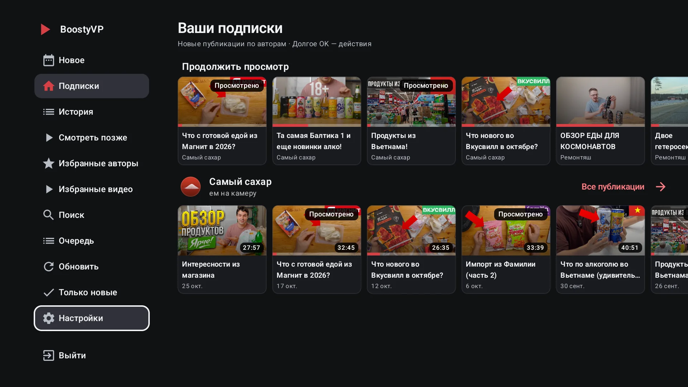

**Подписки** показывают последние публикации по авторам. Авторы загружаются
по мере готовности; ошибка одного не прячет остальных. «Обновить» сохраняет
видимые карточки на время запроса, у ошибки есть повтор.

**Новое** — общая лента подписок с подгрузкой следующих страниц. Она загружается
при первом открытии. «Назад» из неё возвращает к подпискам. **Страница автора**
содержит его публикации, фильтр непросмотренного и собственную подгрузку.

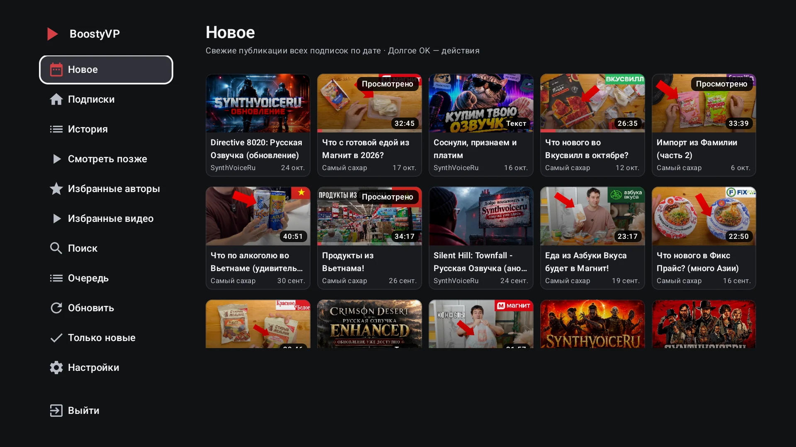

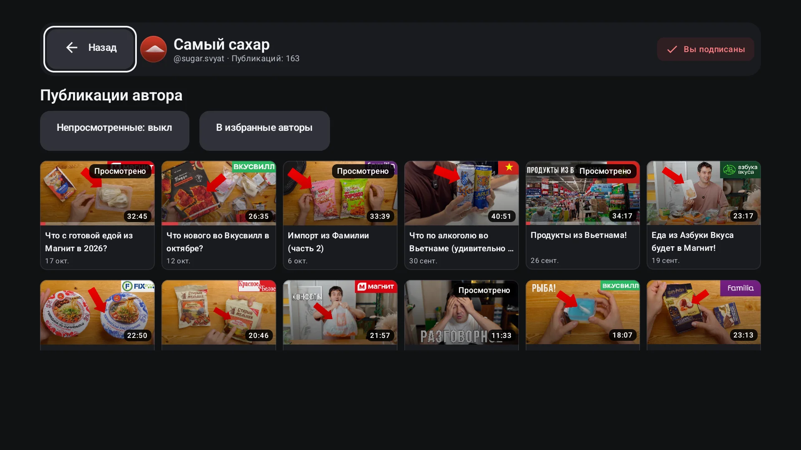

Через долгое OK / Menu доступны открытие, просмотр сначала, переход к автору,
комментарии к видео, очередь, сохранённые списки, отметка просмотренного,
полное название и подробности. Состав зависит от публикации и раздела.
«Смотреть сначала» действует на этот запуск, не отключая сохранение позиций.

- **Продолжить просмотр** — начатые видео с сохранённой позицией.
- **История** — локальная история, включая досмотренное. Удаление одной записи
  не удаляет её позицию и остальные списки.
- **Смотреть позже** — закладки видео и текстов. Это не скачивание.
- **Избранные видео** и **Избранные авторы** — два отдельных списка,
  независимых от «Смотреть позже». Удаление автора из избранного не отменяет подписку.
- **Только новые** — фильтр непросмотренного в подписках/«Новом»; у автора
  отдельный переключатель. Он не скрывает историю и сохранённые списки.
- **Просмотрено / не просмотрено** — отдельная отметка. Не стирает историю
  и позицию. Автоотметка выполняется в последних 5 %, с окном не короче 30 секунд.

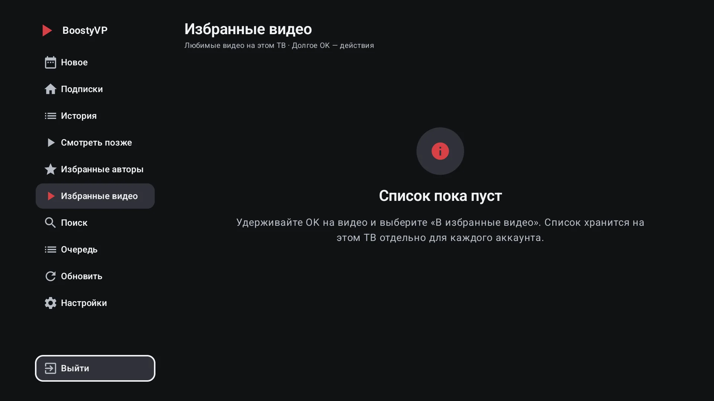

Сохранение карточки не даёт доступ к закрытой публикации: при открытии
подписка проверяется заново. Библиотека хранится на этом ТВ по аккаунтам;
синхронизация между устройствами не реализована.

### Поиск и очередь

**Поиск** охватывает до 600 метаданных уже загруженных публикаций текущего
сеанса, а не весь Boosty. Чтобы расширить охват, загрузите ещё страницы ленты
или автора. Доступны автор, тип публикации, доступность и сортировка.

**Очередь** содержит до 100 видео без дубликатов в текущем сеансе. Долгое OK →
«В очередь просмотра» добавляет/удаляет видео; в разделе можно запустить,
переставить и убрать элементы. Общая очистка подтверждается. Следующий элемент
предлагается с отменяемым отсчётом. Очередь очищается при смене аккаунта
или завершении процесса и не заменяет «Смотреть позже».

## Плеер

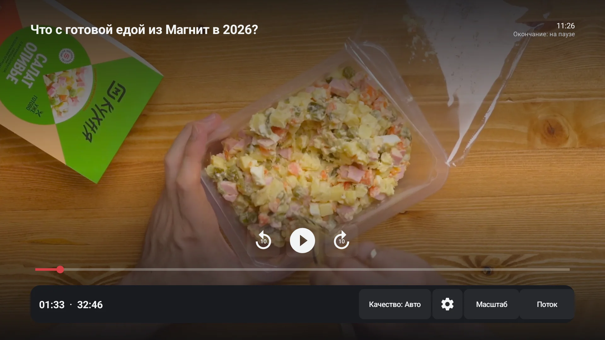

При скрытой панели ←/→ перематывают на настроенный шаг. Быстрые нажатия
складываются, удержание ускоряет перемотку; переход выполняется при отпускании.
На экране видны сдвиг и целевое время. При открытой панели стрелки выбирают
кнопки и шкалу. На паузе панель остаётся видимой до «Назад»; Menu показывает
её без изменения воспроизведения.

Home, переход в другое приложение или на рабочий стол ставит видео на паузу.
Возврат сохраняет точку и прежнее намерение воспроизведения: видео, уже стоявшее
на паузе, не должно самопроизвольно запускаться. Запись позиции на диск зависит
от настройки приватности; при её отключении точка текущей сессии остаётся в памяти.

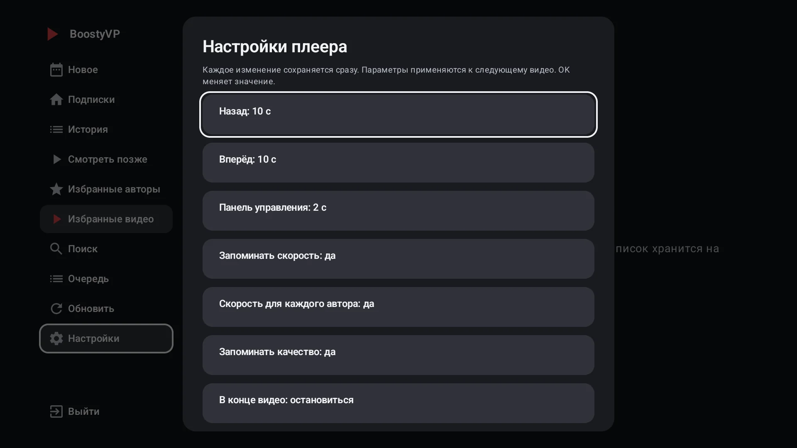

В «Настройки → Плеер» доступны:

- Шаг назад 5/10/15/30 с, вперёд 10/15/30/60 с; панель 2/4/8 с или без автоскрытия.
  По умолчанию: 10 с назад, 30 с вперёд, 4 с панель.
- Запоминание скорости и качества; отдельная скорость автора при включённой настройке.
  Скорость выбирается в меню плеера; качество переносится той же высотой или ближайшей ниже.
- Действие в конце: остановиться (по умолчанию), следующее видео автора,
  повторить или закрыть. Автопереход предлагает отсчёт 8 с: OK запускает сразу,
  другая кнопка отменяет.
- Таймер сна: выключен / 30 мин / 1 / 2 / 3 ч без нажатий пульта → пауза и сообщение.
- Независимые переназначения: CH± между видео автора, FF/REW между видео
  вместо перемотки, цифры 0–9 на 0–90 % длительности. По умолчанию выключены.
- Двойное «Назад»: при скрытых панелях второе нажатие в течение 2 с закрывает
  видео. Закрытие панели не считается подтверждением; по умолчанию выключено.
- Масштаб: вписать, по ширине, по высоте, растянуть, заполнить с обрезкой.
  Это геометрия; цвет, резкость, HDR и обработка изображения не меняются.

«Поток» или INFO показывает кодек/декодер, разрешение, частоту кадров,
заявленный битрейт, аудио, буфер и счётчики кадров. Битрейт не равен скорости
интернета. Неизвестные значения так и подписаны; приватных адресов на панели нет.
«Назад» сначала скрывает сведения, затем панель, затем закрывает видео.

При исчерпании ссылок или длительной буферизации (20 с за минуту) публикация
запрашивается заново, воспроизведение продолжается с прежней точки.
Автоматическое восстановление ограничено интервалом 2 мин; «Попробовать снова»
на экране ошибки выполняется сразу. Во время воспроизведения экран не гаснет;
на паузе действуют обычные правила энергосбережения ТВ.

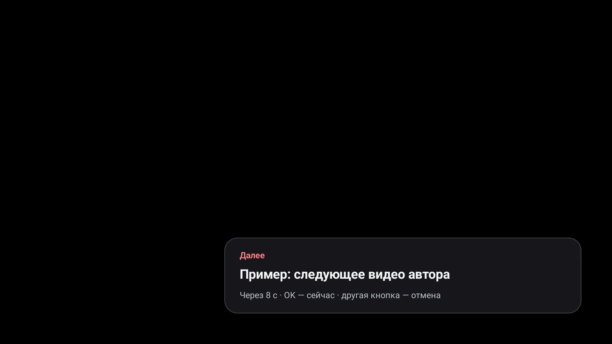

При обычном повторном открытии точка в последних 10 секундах или 5 %
(что больше) начинает видео сначала. Восстановление уже открытого плеера
сохраняет точку текущей сессии.

## Публикации и комментарии

Для видео: **долгое OK на карточке → «Комментарии»**. Обсуждение открывается
сразу, без запуска ролика. Для текстовой публикации короткое OK открывает текст;
комментарии сначала свёрнуты, верхняя кнопка раскрывает и сворачивает их.

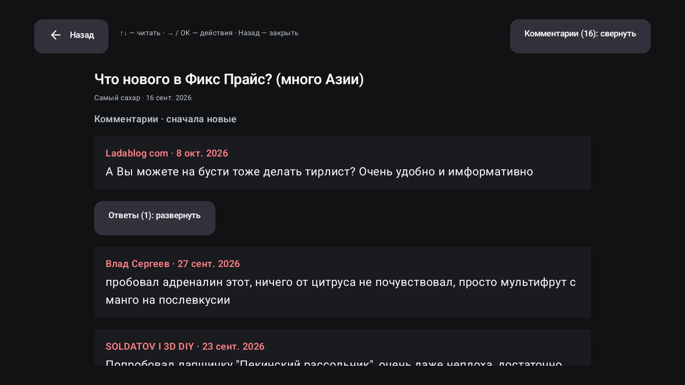

↑/↓ прокручивают текст, Page Up/Down — почти на экран. → или OK переводит фокус
к видимой кнопке ответов / «Загрузить ещё» либо к верхней кнопке комментариев.
← с действия возвращает к чтению. «Назад» возвращает к карточке.
Ответы раскрываются отдельно; следующие страницы догружаются по кнопке.
Комментарии доступны только для чтения: отправка и редактирование не реализованы.
Закрытая публикация показывает доступный анонс; запрещённое автором обсуждение
не запрашивается. Ошибку загрузки можно повторить.

«О публикации» в меню карточки показывает полное название, автора, дату,
доступность, длительность/разрешение при наличии, число комментариев и описание.
↑/↓ прокручивают описание; доступ проверяется свежим запросом.

## Внешний вид, меню и язык

Обычные настройки **сохраняются сразу**. «Назад» и «Закрыть» не отменяют выбор;
отдельная кнопка «Сохранить» не нужна. Подтверждения импорта, сброса и удаления
данных выполняются отдельно.

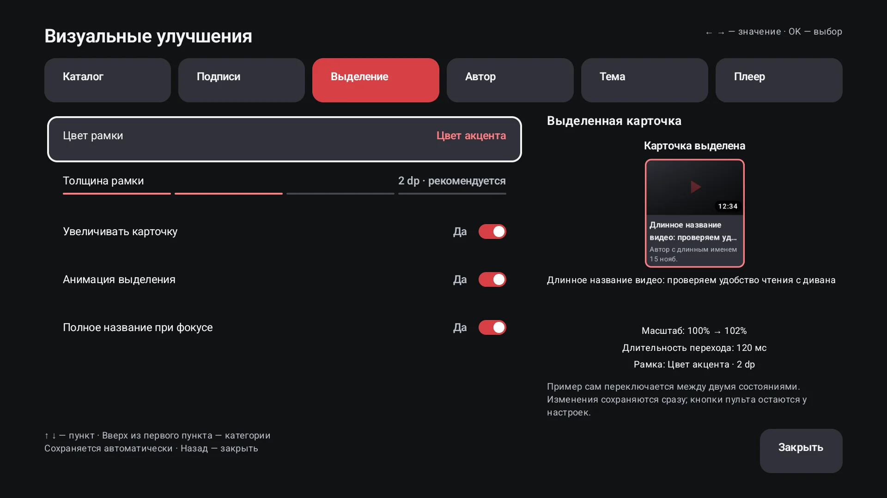

В «Интерфейс» шесть категорий: каталог, подписи, выделение, автор, тема и плеер.
↑/↓ выбирают пункт, ←/→ меняют значение, OK переключает. Есть живой предпросмотр:
выделение чередуется с обычным состоянием и показывает рамку, масштаб и анимацию.

Пять размеров обложек: **96 / 124 / 160 / 216 / 296 dp**. Исходный размер
216 dp — четвёртая ступень; шкала показывает количество полностью видимых
карточек для доступной ширины. Размеры заголовка и метаданных, 1–3 строки,
автор/дата/длительность и скрытие повторного автора настраиваются независимо.
Есть три плотности каталога, два оформления карточки, четыре плотности шапки
автора, чёрная/графитовая темы, пять акцентов, рамка 1–4 dp и отключаемые
увеличение/анимация. Настройки вида плеера не обрабатывают само видео.

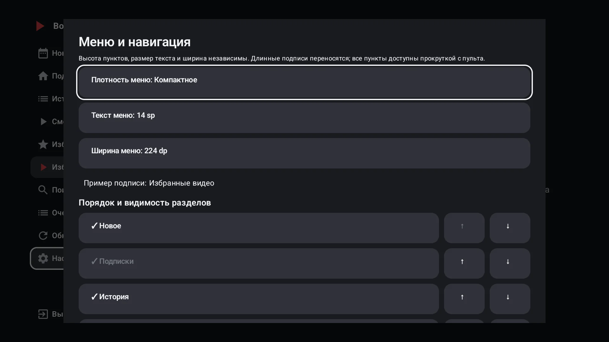

«Меню и навигация»: четыре плотности, текст **12/14/16/18 sp**, ширина
**192/224/256 dp**, порядок и видимость разделов. «Подписки» и «Настройки»
остаются доступны; обновление, фильтр и выход можно скрыть отдельно.
Ширина меню не меняет выбранный размер обложки, но меняет доступное место каталога.

«Язык интерфейса»: системный / Русский / English. Системный выбирает русский
для русской ОС, иначе английский. Смена языка сохраняет вход и библиотеку.
Имена авторов и публикации не переводятся; браузерная страница и штатные
элементы плеера используют выбранный язык.

## Библиотека и приватность

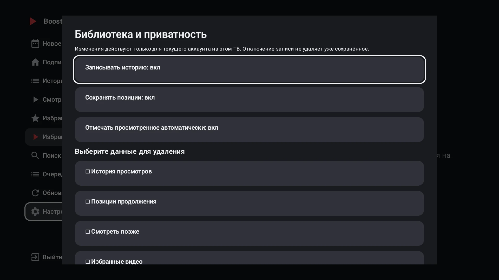

Три переключателя задают запись истории, позиций и автоматических отметок
просмотренного для текущего аккаунта; по умолчанию включены. Отключение записи
не удаляет старые данные и не мешает ручным закладкам.

Для очистки выберите группы: история, позиции, «Смотреть позже», избранные
видео/авторы, отметки просмотренного. «Удалить выбранное…» требует отдельного
подтверждения, где первой выделена «Отмена». Вход, настройки, другие аккаунты
и серверные подписки сохраняются. Очередь очищается отдельно.

## Перенос настроек

JSON содержит только параметры плеера, интерфейса и каналов. **Не содержит**
вход, пароли, токены, аккаунт, подписки, библиотеку, позиции, очередь
или отдельные скорости авторов. Неизвестный формат и ключи отклоняются до записи.

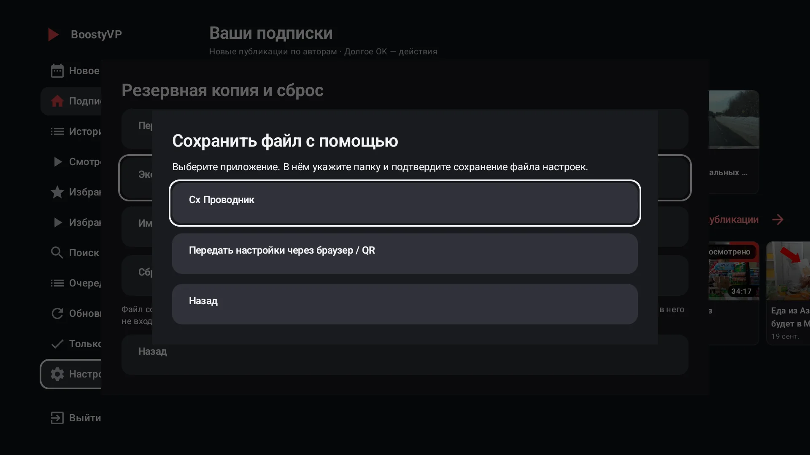

- **Экспортировать в файл на ТВ:** выберите приложение, затем папку и подтвердите
  сохранение в файловом менеджере. На проверенном ТВ работает Cx Проводник.
  Поддерживается и настоящее системное создание документа. Открытие менеджера
  ещё не означает, что файл записан; при отмене настройки не меняются.
- **Импортировать файл:** выберите менеджер/JSON. После успешной проверки
  применяются разрешённые настройки; библиотека и вход не импортируются.
- **Передать настройки через браузер / QR:** откройте адрес в той же доверенной
  сети и скачайте/передайте JSON. Применение загруженного файла подтверждается
  на ТВ. Страница работает до 10 мин, закрывается при выходе из раздела/в фон.
  Если на ТВ нет приложения сохранения, это резервный способ.

Адрес/QR не публикуйте: локальный HTTP не шифрует передачу настроек.
«Сбросить настройки» требует подтверждения, не удаляет вход или библиотеку.

## Каналы Android TV и Projectivy

По умолчанию включён **один канал «Новое»**. В настройках выбираются 1–5 каналов:
новое, продолжение, «Смотреть позже», история, избранные авторы. Источники
не дублируются; лимит — 5–50 карточек на канал. Каналы показывают только видео.

Обновление выполняется при запуске/входе, по кнопке и по расписанию Android
примерно раз в час; ОС может отложить его. При сетевой ошибке сохраняются
последние успешные карточки «Нового». Выход/смена аккаунта очищает карточки.
Порядок и видимость определяет лаунчер; дополнительные каналы разрешаются
в настройках лаунчера или кнопкой приложения. Поддержка зависит от модели
Google TV/лаунчера. Watch Next включается отдельно, по умолчанию выключен.
Лаунчер получает названия, обложки и ссылки открытия, без токенов и медиассылок.

Открытый плеер предоставляет MediaSession для системного управления и сведений
«Сейчас играет». Возможности телефона/голосового клиента зависят от ОС.
После закрытия видео сессия освобождается; фонового проигрывания нет.

## Обновления и помощь

«Настройки → Обновления → Проверить» запрашивает публичный выпуск GitHub,
показывает изменения и предлагает скачать universal APK. При отсутствии
выпусков обновления не предлагаются. Автоматической загрузки/установки нет.
До установки проверяются размер, SHA-256, пакет, версия и сертификат; установка
подтверждается в Android. Повреждённый APK, другая подпись и понижение версии блокируются.

Если кнопка недоступна или функция не работает, проверьте доступность поста,
сеть, Android и версию приложения. Для ошибки без секретов приложите описание
и обезличенный снимок в [Issues](https://github.com/rico-x/BoostyVP/issues).
Токены, адреса сопряжения и приватные медиассылки публиковать нельзя.
Подробности: [безопасность](../SECURITY.md), [данные](PRIVACY.md),
[известные ограничения и roadmap](ROADMAP.md).
